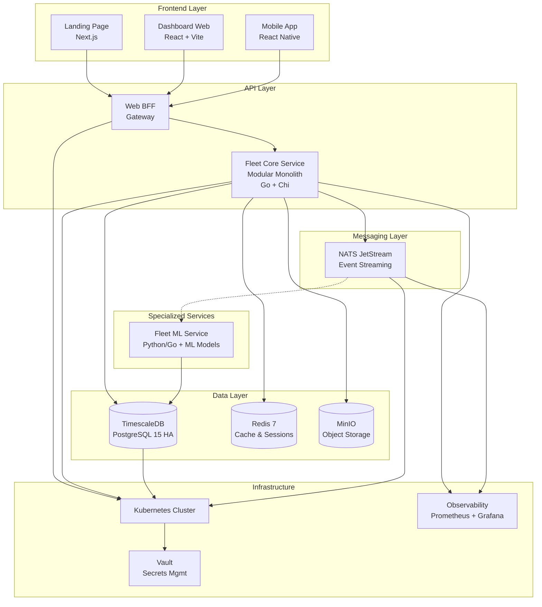
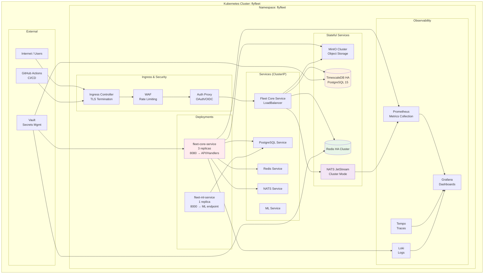
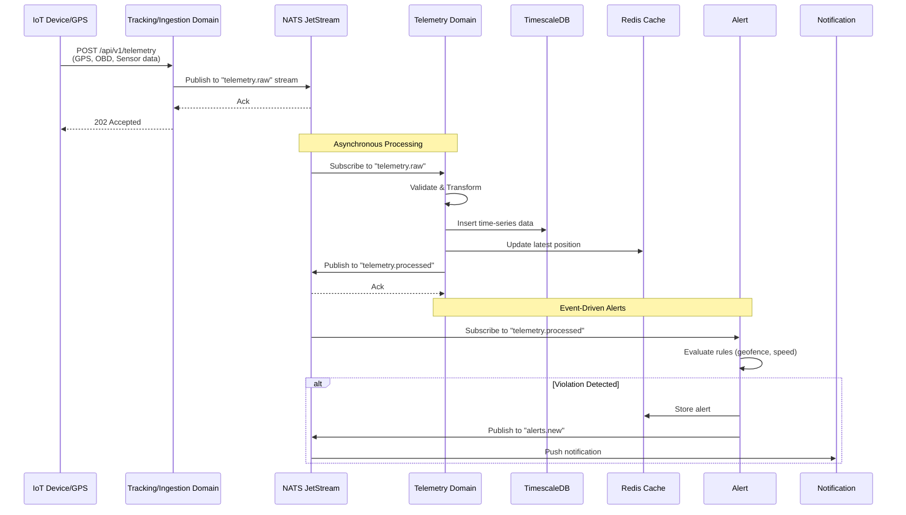
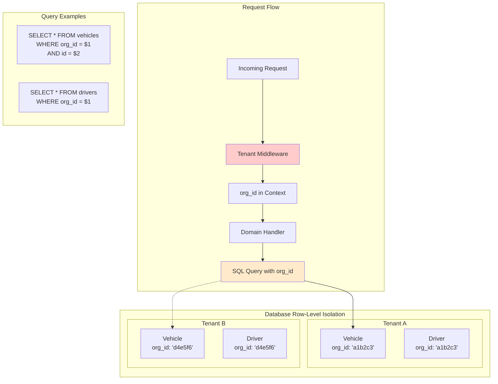
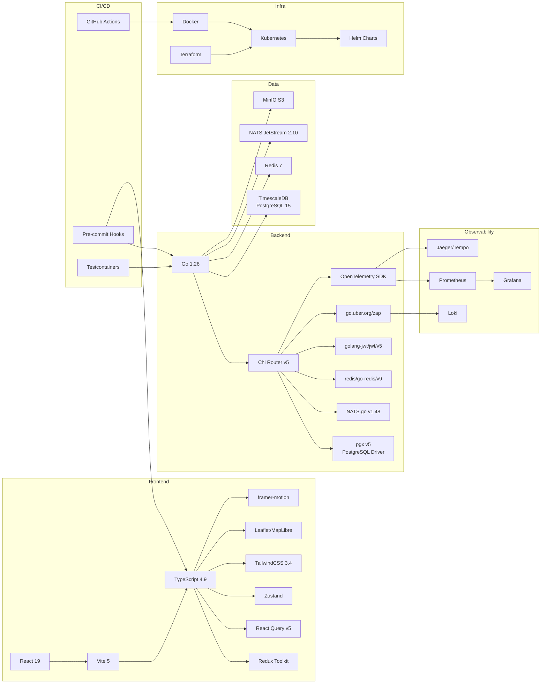
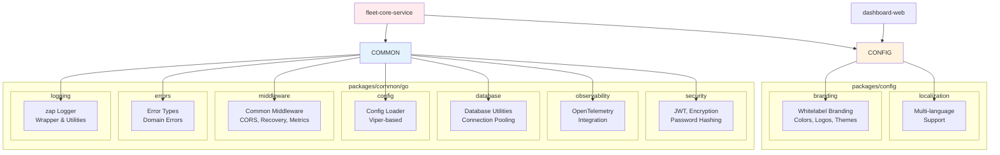

# FlyFleet Architecture Diagrams

Generated: 2026-03-27

---

## 1. High-Level System Architecture



---

## 2. Fleet Core Service Internal Architecture (Modular Monolith)

```mermaid
graph TB
    subgraph "HTTP Layer"
        GW[APIBusGateway<br/>Middleware Chain]
        ROUTER[Chi Router<br/>Route Dispatcher]
    end

    subgraph "Domain Layer (27 Domains)"
        AUTH[Auth Domain]
        VEHICLE[Vehicle Domain]
        DRIVER[Driver Domain]
        TRACKING[Tracking Domain]
        TELEMETRY[Telemetry Domain]
        BILLING[Billing Domain]
        FINANCE[Finance Domain]
        INDIA[India Compliance]
        EMERGENCY[Emergency Domain]
        ALERT[Alert Domain]
        MAINTENANCE[Maintenance Domain]
        TRIP[Trip Domain]
        ANALYTICS[Analytics Domain]
        REPORTS[Reports Domain]
        GOVERNANCE[Governance Domain]
        SETTINGS[Settings Domain]
        INTEGRATIONS[Integrations Domain]
        COMPLIANCE[Compliance Domain]
        FUEL[Fuel Domain]
        GEOFENCING[Geofencing Domain]
        ROUTE[Route Domain]
        VIDEO[Video Domain]
        CUSTOMER[Customer Domain]
        DIAGNOSTICS[Diagnostics Domain]
        MONITORING[Monitoring Domain]
        ADMIN[Admin Support]
        PLATFORM[Platform Compat]
    end

    subgraph "Cross-Cutting Concerns"
        PLATFORM_LAYER[Platform Layer<br/>iam/, billing/, events/,<br/>gateway/, middleware/, metrics/]
        OBSERVABILITY[Observability<br/>Logging, Metrics, Traces]
    end

    subgraph "Infrastructure Layer"
        DB[(PostgreSQL<br/>Repository Pattern)]
        REDIS_CACHE[(Redis Cache)]
        EVENTBUS[NATS EventBus]
        MINIO_S3[(MinIO S3)]
    end

    GW --> ROUTER

    ROUTER --> AUTH
    ROUTER --> VEHICLE
    ROUTER --> DRIVER
    ROUTER --> TRACKING
    ROUTER --> TELEMETRY
    ROUTER --> BILLING
    ROUTER --> FINANCE
    ROUTER --> INDIA
    ROUTER --> EMERGENCY
    ROUTER --> ALERT
    ROUTER --> MAINTENANCE
    ROUTER --> TRIP
    ROUTER --> ANALYTICS
    ROUTER --> REPORTS
    ROUTER --> GOVERNANCE
    ROUTER --> SETTINGS
    ROUTER --> INTEGRATIONS
    ROUTER --> COMPLIANCE
    ROUTER --> FUEL
    ROUTER --> GEOFENCING
    ROUTER --> ROUTE
    ROUTER --> VIDEO
    ROUTER --> CUSTOMER
    ROUTER --> DIAGNOSTICS
    ROUTER --> MONITORING
    ROUTER --> ADMIN
    ROUTER --> PLATFORM

    AUTH --> PLATFORM_LAYER
    VEHICLE --> PLATFORM_LAYER
    DRIVER --> PLATFORM_LAYER
    TRACKING --> PLATFORM_LAYER

    PLATFORM_LAYER --> OBSERVABILITY

    AUTH --> DB
    VEHICLE --> DB
    DRIVER --> DB
    TRACKING --> DB

    AUTH --> REDIS_CACHE
    VEHICLE --> REDIS_CACHE

    TELEMETRY --> EVENTBUS
    TRACKING --> EVENTBUS
    ALERT --> EVENTBUS

    BILLING --> MINIO_S3
    REPORTS --> MINIO_S3

    style FC fill:#e1f5ff
    style GW fill:#f0f0f0
    style DB fill:#fff3e0
    style NATS fill:#f3e5f5
```



---

## 3. Domain Internal Structure (Hexagonal Pattern)

```mermaid
graph LR
    subgraph "Domain: Example (Auth)"
        H[Handlers<br/>HTTP Adapters]
        S[Service<br/>Application Logic]
        R[Repository<br/>Persistence Adapter]
        M[Models/DTOs<br/>Domain Objects]
    end

    subgraph "Infrastructure"
        DB_EXT[(PostgreSQL<br/>External)]
        REDIS_EXT[(Redis<br/>External)]
    end

    H --> S
    S --> R
    R --> DB_EXT
    S --> M
    H --> M
    M --> S

    H -.-> REDIS_EXT
    S -.-> EVENTBUS[NATS EventBus]
    S -.-> MINIO[MinIO S3]
    S -.-> EXTERNAL[Third-Party APIs]
    end

    style H fill:#e8f5e8
    style S fill:#e3f2fd
    style R fill:#fff3e0
    style M fill:#f3e5f5
```

---

## 4. Deployment Architecture



---

## 5. Data Flow: Telemetry Ingestion



---

## 6. API Gateway Request Flow

```mermaid
flowchart TD
    Start[Client Request] --> Gateway{APIBusGateway Middleware}

    Gateway --> Log[1. Log Request & Metrics]
    Log --> Tenant{2. Tenant Context Check}

    Tenant -->|Public Route| AuthCheck[3. Skip Auth]
    Tenant -->|Private Route| ValidateJWT[3. Validate JWT<br/>JWKS]

    AuthCheck --> Router[4. Chi Router<br/>Route to Domain Handler]
    ValidateJWT --> Router

    Router --> DomainHandler[Domain Handler<br/>(e.g., AuthHandlers)]

    DomainHandler --> Service[Service Layer<br/>Business Logic]
    Service --> Repo[Repository<br/>Data Access]
    Repo --> DB[(Database)]

    Service --> EventBus[NATS EventBus<br/>Publish Events]
    Service --> Cache[Redis Cache<br/>Read/Write]

    Repo --> Result[Return Results]
    EventBus --> Async[Async Processing]
    Cache --> FastReturn[Fast Response]

    Result --> DomainHandler
    DomainHandler --> Gateway
    Gateway --> Response[HTTP Response]

    Response --> End[Client]

    style Gateway fill:#e3f2fd
    style Service fill:#f3e5f5
    style Repo fill:#fff3e0
    style DB fill:#ffebee
```

---

## 7. Multi-Tenancy Isolation



---

## 8. Technology Stack Map



---

## 9. Proto/API Contracts

```mermaid
graph TB
    subgraph "Proto Definitions<br/>(proto/ directory)"
        A_AUTH[auth/v1/auth.proto]
        A_VEHICLE[vehicle/v1/vehicle.proto]
        A_DRIVER[driver/v1/driver.proto]
        A_TRACKING[tracking/v1/tracking.proto]
        A_BILLING[billing/v1/billing.proto]
        A_INDIA[india/v1/india.proto]
        A_ALERT[alert/v1/alert.proto]
        A_ANALYTICS[analytics/v1/analytics.proto]
        A_COMPLIANCE[compliance/v1/compliance.proto]
        A_FLEET[fleet/v1/fleet.proto]
        A_MAINT[maintenance/v1/maintenance.proto]
        A_REPORTS[reports/v1/reports.proto]
        A_ADMIN[admin/v1/admin.proto]
    end

    subgraph "Generated Code (Go)"
        GEN_AUTH[github.com/flyfleet/proto/auth/v1]
        GEN_VEHICLE[github.com/flyfleet/proto/vehicle/v1]
        GEN_DRIVER[github.com/flyfleet/proto/driver/v1]
        GEN_TRACKING[github.com/flyfleet/proto/tracking/v1]
    end

    subgraph "Generated Code (TypeScript)"
        TS_CLIENTS[@flyfleet/api-clients]
    end

    A_AUTH --> GEN_AUTH
    A_VEHICLE --> GEN_VEHICLE
    A_DRIVER --> GEN_DRIVER
    A_TRACKING --> GEN_TRACKING
    A_BILLING --> GEN_BILLING
    A_INDIA --> GEN_INDIA

    GEN_AUTH --> AUTH_HANDLERS[Auth Handlers]
    GEN_VEHICLE --> VEHICLE_HANDLERS[Vehicle Handlers]
    GEN_DRIVER --> DRIVER_HANDLERS[Driver Handlers]
    GEN_TRACKING --> TRACKING_HANDLERS[Tracking Handlers]

    AUTH_HANDLERS --> TS_CLIENTS
    VEHICLE_HANDLERS --> TS_CLIENTS
    DRIVER_HANDLERS --> TS_CLIENTS
    TRACKING_HANDLERS --> TS_CLIENTS

    TS_CLIENTS --> DASHBOARD[Dashboard Web]
    TS_CLIENTS --> MOBILE[Mobile App]

    style A_AUTH fill:#e8f5e8
    style GEN_AUTH fill:#e3f2fd
    style TS_CLIENTS fill:#f3e5f5
```

---

## 10. Shared Packages Structure



---

## Notes

- Diagrams represent architecture as of March 2026 (based on codebase exploration)
- Some components (e.g., auth-service, ingestion-service separate deployments) appear to be legacy K8s configs
- Current primary deployment is fleet-core-service monolith with 3 replicas
- Event-driven architecture via NATS JetStream enables loose coupling
- Modular monolith allows easy future extraction of domains to microservices
