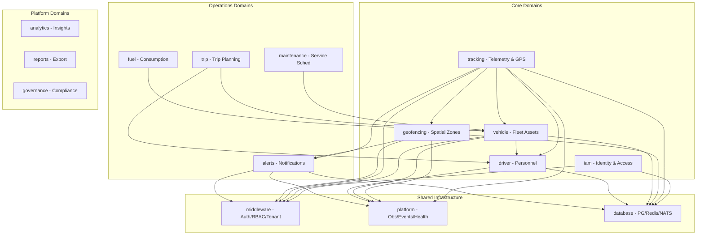

# Vehicle Tracking & Dispatcher — System Architecture

**Document ID:** ARCH-VT-003  
**Version:** 1.0  
**Status:** Draft  
**Created:** April 8, 2026  
**Author:** Senior Architect  
**Parent Spec:** [Vehicle Tracking Dispatcher PSPEC](../product-spec/VEHICLE_TRACKING_DISPATCHER.md)  
**Supersedes:** [VEHICLE_TRACKING.md](./VEHICLE_TRACKING.md), [VEHICLE_TRACKING_IMPLEMENTATION.md](./VEHICLE_TRACKING_IMPLEMENTATION.md)

---

## 1. Executive Summary

### 1.1 Purpose

This document defines the **canonical architecture** for the Vehicle Tracking & Dispatcher feature within the FlyFleet modular monolith. It consolidates the product specification, existing architecture drafts, and the actual fleet-core codebase into a single authoritative reference.

### 1.2 User Story

> As a dispatcher, I want to see all my vehicles on a map with live positions so that I know where every vehicle is right now.

### 1.3 Key Design Principles

| Principle | Application |
|-----------|------------|
| **Modular Monolith** | All tracking code lives inside `services/fleet-core/` — no separate microservices |
| **Hexagonal Architecture** | Each domain follows: handlers → service → repository → models |
| **Shared Infrastructure** | Database pools, Redis, NATS, observability provided by `internal/platform/` |
| **Feature Flags** | Kill switches for each capability (map, real-time, geofence, history) |
| **Tenant Isolation** | All queries scoped by `tenant_id` via `TenantContextMiddleware` |

---

## 2. System Context

### 2.1 C4 Level 1 — System Context

```
┌──────────────────────────────────────────────────────────────────────┐
│                        External Actors                                │
│                                                                       │
│  ┌──────────────┐    ┌──────────────┐    ┌──────────────────────┐   │
│  │ GPS Devices  │    │ Dispatcher   │    │ Third-party Systems  │   │
│  │ (AIS-140)    │    │ (Dashboard)  │    │ (FASTag, VAHAN)      │   │
│  └──────┬───────┘    └──────┬───────┘    └──────────────────────┘   │
│         │                   │                                        │
└─────────┼───────────────────┼────────────────────────────────────────┘
          │                   │
          ▼                   ▼
┌──────────────────────────────────────────────────────────────────────┐
│                    FlyFleet Platform Boundary                         │
│                                                                       │
│  ┌─────────────────────────────────────────────────────────────────┐ │
│  │  Fleet-Core Monolith (Go / Chi Router / Port 8084)              │ │
│  │                                                                  │ │
│  │  Domains: tracking, geofencing, vehicle, driver, alerts, iam    │ │
│  │  Shared: middleware, platform, messaging, database              │ │
│  └────────────────────────┬────────────────────────────────────────┘ │
│                           │                                          │
│                           ▼                                          │
│  ┌─────────────────────────────────────────────────────────────────┐ │
│  │  Data Layer: PostgreSQL + TimescaleDB + PostGIS                 │ │
│  │  Cache: Redis 7+                                                │ │
│  │  Message Bus: NATS JetStream                                    │ │
│  └─────────────────────────────────────────────────────────────────┘ │
└──────────────────────────────────────────────────────────────────────┘
```

### 2.2 Container-Level (C4 Level 2)

```
┌─────────────────────────────────────────────────────────────────────────┐
│                     dashboard-web (React SPA)                            │
│  Port: 3000 (dev) / CDN (prod)                                          │
│  Components: VehicleMap, VehicleDetailPanel, SearchBar, WebSocketClient │
└───────────────────────┬─────────────────────────────────────────────────┘
                        │ HTTPS + WSS
                        ▼
┌─────────────────────────────────────────────────────────────────────────┐
│              Fleet-Core Monolith (Go / Chi / Port 8084)                  │
│                                                                          │
│  ┌───────────────────────────────────────────────────────────────────┐  │
│  │  Middleware Stack                                                  │  │
│  │  CORS → SecurityHeaders → RequestLogging → JWKSAuth →            │  │
│  │  TenantContext → RBAC → RateLimit → TraceID                      │  │
│  └────────────────────────────┬──────────────────────────────────────┘  │
│                               │                                          │
│  ┌──────────────┐ ┌──────────┴──────────┐ ┌────────────────────────┐   │
│  │ iam/         │ │ tracking/           │ │ geofencing/            │   │
│  │ - JWT auth   │ │ - Telemetry ingest  │ │ - Geofence CRUD        │   │
│  │ - RBAC       │ │ - Live location     │ │ - Spatial detection    │   │
│  │ - Sessions   │ │ - History/replay    │ │ - Entry/exit events    │   │
│  │ - MFA        │ │ - WebSocket push    │ │ - Alert integration    │   │
│  │ - Password   │ │ - Anomaly detect    │ │ - PostGIS queries      │   │
│  └──────────────┘ └──────────┬──────────┘ └───────────┬────────────┘   │
│                              │                         │                 │
│  ┌──────────────┐ ┌─────────┴──────────┐ ┌────────────┴────────────┐  │
│  │ vehicle/     │ │ driver/            │ │ alerts/                  │  │
│  │ - Vehicle    │ │ - Driver CRUD      │ │ - Multi-channel notify   │  │
│  │   lifecycle  │ │ - Behavior scoring │ │ - Preference engine      │  │
│  │ - Bulk ops   │ │ - Background jobs  │ │ - Template engine        │  │
│  │ - Compliance │ │                    │ │ - Provider abstraction   │  │
│  └──────────────┘ └────────────────────┘ └─────────────────────────┘  │
│                                                                          │
│  ┌───────────────────────────────────────────────────────────────────┐  │
│  │  Shared Infrastructure (internal/platform/)                        │  │
│  │  - EventBus (NATS)    - Health Checks      - Metrics (Prometheus) │  │
│  │  - Observability      - Response Helpers    - IAM Platform Svc    │  │
│  └───────────────────────────────────────────────────────────────────┘  │
└───────────────────────────────┬─────────────────────────────────────────┘
                                │
          ┌─────────────────────┼─────────────────────┐
          ▼                     ▼                     ▼
┌───────────────────┐ ┌───────────────────┐ ┌───────────────────┐
│ PostgreSQL 15     │ │    Redis 7+       │ │  NATS JetStream   │
│ + TimescaleDB     │ │  - Live cache     │ │  - Telemetry      │
│ + PostGIS         │ │  - Pub/Sub        │ │    events         │
│                   │ │  - Session store  │ │  - Geofence       │
│ Tables:           │ │                   │ │    events         │
│ - telemetry_points│ │                   │ │  - Alert          │
│ - vehicles        │ │                   │ │    delivery       │
│ - drivers         │ │                   │ │                   │
│ - geofences       │ │                   │ │                   │
│ - geofence_events │ │                   │ │                   │
│ - gps_locations   │ │                   │ │                   │
└───────────────────┘ └───────────────────┘ └───────────────────┘
```

---

## 3. Fleet-Core Domain Architecture

### 3.1 Domain Dependency Graph



### 3.2 Domain Details

#### 3.2.1 Tracking Domain (`internal/domains/tracking/`)

**Responsibility:** GPS telemetry ingestion, live location queries, history replay, anomaly detection, device management.

**Subdirectories:**
| Package | Files | Purpose |
|---------|-------|---------|
| `handlers/` | `ingest_handler.go`, `tracking_query_handler.go`, `device_handler.go`, `device_command_handler.go`, `websocket.go`, `analytics_handler.go` | HTTP/WebSocket endpoints |
| `service/` | `ingestion_service.go`, `telemetry_query_service.go`, `anomaly_engine.go`, `alert_service.go`, `batch_location_service.go` | Business logic |
| `repository/` | `telemetry_repository.go`, `live_cache_repository.go`, `device_repository.go`, `analytics_repository.go` | Data access (implements interfaces) |
| `models/` | `telemetry.go`, `device.go`, `analytics.go` | Domain entities |
| `processor/` | Binary codec, telemetry processor | Data transformation |
| `worker/` | Background workers, telemetry processors | Async processing |
| `analytics/` | Telemetry analytics pipeline | Derived metrics |

**Key Endpoints:**
| Path | Method | Handler | Status |
|------|--------|---------|--------|
| `/api/v1/telemetry` | POST | `ingest_handler.go` | ✅ Live |
| `/api/v1/vehicles/{id}/location` | GET | `tracking_query_handler.go` | ✅ Live |
| `/api/v1/vehicles/{id}/history` | GET | `tracking_query_handler.go` | ✅ Live |
| `/api/v1/vehicles/{id}/replay` | GET | `tracking_query_handler.go` | ✅ Live |
| `/api/v1/vehicles/nearby` | GET | `tracking_query_handler.go` | ✅ Live |
| `/api/v1/devices/{id}` | GET/PUT/DELETE | `device_handler.go` | ✅ Live |
| `/api/v1/devices/{id}/commands` | POST | `device_command_handler.go` | ✅ Live |
| `/ws/telemetry` | WS | `websocket.go` | ✅ Live |
| **`/api/v1/vehicles/locations`** | **GET** | **`vehicle_locations_handler.go`** | **NEW — Bulk org vehicle positions** |

**Data Flow — Telemetry Ingest:**
```
1. GPS device → POST /api/v1/telemetry
2. IngestHandler validates HMAC, extracts tenant from context
3. IngestionService validates coords, deduplicates by sequence_no
4. Writes to telemetry_points (TimescaleDB hypertable)
5. Updates Redis live cache (vehicle:{id}:live, TTL 5min)
6. Publishes to NATS "fleet.telemetry.gps"
7. Publishes to Redis pub/sub "org:{org_id}:telemetry" (for WS fan-out)
8. Returns 202 Accepted
```

**Data Flow — Bulk Map Load:**
```
1. Dashboard → GET /api/v1/vehicles/locations
2. VehicleLocationsHandler extracts org_id from context
3. VehicleRepository.GetOrgVehicles() → all org vehicles
4. LiveCacheRepository.GetBatchLiveLocations() → Redis pipeline (500 keys ~50ms)
5. DriverRepository.GetByIDs() → batch driver enrichment
6. Service layer calculates status (moving/idle/stopped/offline)
7. Returns enriched JSON response with meta summary
```

**Data Flow — WebSocket Real-time:**
```
1. Dashboard → WS /ws/telemetry?token=xxx&org_id=yyy
2. WebSocketHandler validates JWT, upgrades connection
3. Registers client in org-scoped hub
4. Subscribes to Redis pub/sub "org:{org_id}:telemetry"
5. On Redis message → broadcast to all org's WS clients
6. Heartbeat: ping/pong every 30s for health monitoring
7. Position updates: 5s interval ticker, only sends changed positions
8. On disconnect → unregister, cleanup
```

#### 3.2.2 Geofencing Domain (`internal/domains/geofencing/`)

**Responsibility:** Spatial zone management, PostGIS-based entry/exit/dwell detection.

**Subdirectories:**
| Package | Files | Purpose |
|---------|-------|---------|
| `engine/` | `geofence_engine.go` | PostGIS spatial detection, NATS subscriber |
| `service/` | `geofence_service.go` | CRUD operations, event publishing |
| `handlers/` | `geofence_handler.go` | HTTP endpoints |
| `repository/` | Geofence data access | PostGIS queries |
| `models/` | `geofence.go` | Circle, polygon, corridor geofences |

**Geofence Detection Flow:**
```
1. GPS device → POST /api/v1/telemetry
2. IngestionService publishes to NATS "fleet.telemetry.gps"
3. GeofenceEngine (subscribed to NATS) receives GPS event
4. Queries active geofences for vehicle from DB
5. PostGIS check: ST_DWithin (circle) or ST_Within (polygon)
6. Compares with previous state (Redis: vehicle_state:{vehicle_id})
7. If state changed → insert geofence_events record
8. Publish to NATS "fleet.geofence.events"
9. Publish to Redis "org:{org_id}:geofence_alerts"
10. AlertService consumes → multi-channel notification
11. WebSocket handler receives alert → pushes to dashboard
```

#### 3.2.3 Vehicle Domain (`internal/domains/vehicle/`)

**Responsibility:** Vehicle lifecycle management, bulk operations, compliance, documents.

**Subdirectories:**
| Package | Files | Purpose |
|---------|-------|---------|
| `handlers/` | `vehicle_handler.go`, `bulk_handler.go`, `compliance_handler.go`, `doc_handler.go`, `lifecycle_handler.go`, `trip_handler.go` | All vehicle HTTP endpoints |
| `service/` | Vehicle services | Business logic |
| `repository/` | Vehicle data access | PostgreSQL queries |
| `models/` | Vehicle entities | Domain models |
| `crypto/` | AES encryption | Sensitive data encryption |
| `processor/` | Bulk processors | Batch operations |
| `middleware/` | Vehicle-specific middleware | Validation, authorization |

**Key Integration with Tracking:**
- `VehicleRepository.GetOrgVehicles()` — returns all vehicles for an org (used by bulk locations endpoint)
- `VehicleRepository.GetDriverInfo()` — joins with drivers table for enrichment
- Vehicle metadata (registration, make, model) enriches WebSocket position updates

#### 3.2.4 Driver Domain (`internal/domains/driver/`)

**Responsibility:** Driver management, behavior scoring, background workers.

**Integration with Tracking:**
- Driver name/phone enrichment in bulk locations response
- `DriverRepository.GetByIDs()` — batch query for performance
- Behavior scoring feeds into anomaly detection in tracking domain

#### 3.2.5 Alerts Domain (`internal/domains/alerts/`)

**Responsibility:** Multi-channel notifications, preference engine, template engine, provider abstraction.

**Subdirectories:**
| Package | Files | Purpose |
|---------|-------|---------|
| `handlers/` | Alert management endpoints | HTTP endpoints |
| `service/` | Alert processing | Business logic |
| `repository/` | Alert data access | PostgreSQL |
| `models/` | Alert entities | Domain models |
| `preference_engine/` | User preferences | Channel selection logic |
| `template_engine/` | Message templates | Rendered notifications |
| `provider_clients/` | External providers | SMS, email, push clients |
| `notification_worker/` | Background workers | Async delivery |
| `alert_router/` | Routing logic | Alert type → channel mapping |

**Geofence Alert Flow:**
```
1. GeofenceEngine detects entry/exit → NATS "fleet.geofence.events"
2. AlertService consumes event
3. PreferenceEngine looks up user's notification preferences
4. TemplateEngine renders alert message
5. ProviderClients dispatches (in-app, email, SMS, webhook)
6. Alert logged to geofence_events table (audit trail)
```

---

## 4. Middleware Stack

All requests pass through the middleware chain defined in `internal/middleware/`:

```
HTTP Request
    │
    ▼
┌─────────────────────────────────┐
│ 1. CORS (cors.go)               │  ← Allow origins, methods, headers
└────────────┬────────────────────┘
             ▼
┌─────────────────────────────────┐
│ 2. SecurityHeaders              │  ← CSP, HSTS, X-Frame-Options
│    (security_headers.go)        │
└────────────┬────────────────────┘
             ▼
┌─────────────────────────────────┐
│ 3. RequestLogging (logging.go)  │  ← Correlation ID, method, path
└────────────┬────────────────────┘
             ▼
┌─────────────────────────────────┐
│ 4. TraceID (trace_id.go)        │  ← Distributed tracing propagation
└────────────┬────────────────────┘
             ▼
┌─────────────────────────────────┐
│ 5. JWKSAuth (jwks_auth.go)      │  ← JWT validation via JWKS
│    (for authenticated routes)   │
└────────────┬────────────────────┘
             ▼
┌─────────────────────────────────┐
│ 6. TenantContext (tenant.go)    │  ← Extract org_id → context
└────────────┬────────────────────┘
             ▼
┌─────────────────────────────────┐
│ 7. RBAC (rbac.go)               │  ← Role/permission checks
│    + RequireRoleForMutations    │  ← Write ops require specific roles
└────────────┬────────────────────┘
             ▼
┌─────────────────────────────────┐
│ 8. RateLimit (ratelimit.go)     │  ← Per-IP/per-user throttling
└────────────┬────────────────────┘
             ▼
┌─────────────────────────────────┐
│ 9. Idempotency (idempotency.go) │  ─── Protect against duplicate requests
└────────────┬────────────────────┘
             ▼
┌─────────────────────────────────┐
│ 10. SystemGuard                 │  ← System-level protection
│     (system_guard.go)           │
└────────────┬────────────────────┘
             ▼
         Handler
```

**For Tracking Endpoints:**
- `/api/v1/telemetry` (POST) → HMAC auth + device rate limit (5Hz)
- `/api/v1/vehicles/locations` (GET) → JWKS + TenantContext + RBAC (dispatcher role)
- `/api/v1/vehicles/{id}/telemetry/history` (GET) → JWKS + TenantContext + RBAC
- `/ws/telemetry` (WS) → JWT in query param + org_id validation
- `/api/v1/geofences` (GET/POST) → JWKS + TenantContext + RBAC

---

## 5. Data Architecture

### 5.1 Database Schema

#### 5.1.1 Core Tables

**`telemetry_points`** — TimescaleDB Hypertable (partitioned by month)
```sql
CREATE TABLE telemetry_points (
    time            TIMESTAMPTZ NOT NULL,
    vehicle_id      UUID NOT NULL,
    device_id       UUID,
    latitude        DOUBLE PRECISION NOT NULL,
    longitude       DOUBLE PRECISION NOT NULL,
    speed_kmh       DOUBLE PRECISION,
    heading         DOUBLE PRECISION,
    altitude_m      DOUBLE PRECISION,
    ignition        BOOLEAN,
    fuel_level      DOUBLE PRECISION,
    odometer_km     DOUBLE PRECISION,
    event_type      VARCHAR(20),
    sequence_no     BIGINT,
    raw_data        JSONB,
    tenant_id       UUID NOT NULL,
    created_at      TIMESTAMPTZ DEFAULT NOW(),

    CONSTRAINT fk_telemetry_vehicle FOREIGN KEY (vehicle_id) REFERENCES vehicles(id),
    CONSTRAINT fk_telemetry_tenant FOREIGN KEY (tenant_id) REFERENCES organizations(id)
);

-- Hypertable creation
SELECT create_hypertable('telemetry_points', 'time',
    chunk_time_interval => INTERVAL '1 month',
    if_not_exists => true);

-- Compression policy (chunks older than 7 days)
SELECT add_compression_policy('telemetry_points', INTERVAL '7 days');

-- Retention policy (drop raw data older than 90 days)
SELECT add_drop_chunks_policy('telemetry_points', INTERVAL '90 days');

-- Indexes
CREATE INDEX idx_telemetry_vehicle_time ON telemetry_points (vehicle_id, time DESC);
CREATE INDEX idx_telemetry_tenant_time ON telemetry_points (tenant_id, time DESC);
```

**`gps_locations`** — Latest position cache table
```sql
CREATE TABLE gps_locations (
    id              UUID PRIMARY KEY DEFAULT gen_random_uuid(),
    vehicle_id      UUID NOT NULL UNIQUE REFERENCES vehicles(id),
    device_id       UUID,
    latitude        DOUBLE PRECISION NOT NULL,
    longitude       DOUBLE PRECISION NOT NULL,
    speed_kmh       DOUBLE PRECISION,
    heading         DOUBLE PRECISION,
    ignition        BOOLEAN,
    fuel_level      DOUBLE PRECISION,
    odometer_km     DOUBLE PRECISION,
    last_seen       TIMESTAMPTZ NOT NULL,
    status          VARCHAR(20) DEFAULT 'online',
    tenant_id       UUID NOT NULL,
    created_at      TIMESTAMPTZ DEFAULT NOW(),
    updated_at      TIMESTAMPTZ DEFAULT NOW()
);

CREATE INDEX idx_gps_locations_tenant ON gps_locations (tenant_id);
CREATE INDEX idx_gps_locations_last_seen ON gps_locations (last_seen DESC);
```

**`vehicles`** — Fleet assets
```sql
CREATE TABLE vehicles (
    id                  UUID PRIMARY KEY DEFAULT gen_random_uuid(),
    registration_number VARCHAR(20) NOT NULL,
    make                VARCHAR(50),
    model               VARCHAR(50),
    year                INTEGER,
    vin                 VARCHAR(17),
    current_driver_id   UUID REFERENCES drivers(id),
    status              VARCHAR(20) DEFAULT 'active',
    tenant_id           UUID NOT NULL REFERENCES organizations(id),
    deleted_at          TIMESTAMPTZ,
    created_at          TIMESTAMPTZ DEFAULT NOW(),
    updated_at          TIMESTAMPTZ DEFAULT NOW()
);

CREATE INDEX idx_vehicles_org_id ON vehicles (tenant_id, status, deleted_at);
CREATE INDEX idx_vehicles_registration ON vehicles (registration_number);
```

**`drivers`** — Personnel
```sql
CREATE TABLE drivers (
    id          UUID PRIMARY KEY DEFAULT gen_random_uuid(),
    name        VARCHAR(100) NOT NULL,
    phone       VARCHAR(20),
    license_no  VARCHAR(20),
    status      VARCHAR(20) DEFAULT 'active',
    tenant_id   UUID NOT NULL REFERENCES organizations(id),
    created_at  TIMESTAMPTZ DEFAULT NOW(),
    updated_at  TIMESTAMPTZ DEFAULT NOW()
);

CREATE INDEX idx_drivers_tenant ON drivers (tenant_id, status);
```

#### 5.1.2 Geofencing Tables

**`geofences`** — Spatial zone definitions
```sql
CREATE TABLE geofences (
    id                  UUID PRIMARY KEY DEFAULT gen_random_uuid(),
    tenant_id           UUID NOT NULL REFERENCES organizations(id),
    name                VARCHAR(100) NOT NULL,
    description         TEXT,
    type                VARCHAR(20) CHECK (type IN ('circle', 'polygon', 'corridor')),
    center_lat          DOUBLE PRECISION,
    center_lng          DOUBLE PRECISION,
    radius_m            DOUBLE PRECISION,
    polygon             GEOMETRY(POLYGON, 4326),
    corridor            GEOMETRY(LINESTRING, 4326),
    corridor_buffer_m   DOUBLE PRECISION,
    status              VARCHAR(20) DEFAULT 'active',
    alert_channels      JSONB DEFAULT '["in_app"]',
    created_at          TIMESTAMPTZ DEFAULT NOW(),
    updated_at          TIMESTAMPTZ DEFAULT NOW()
);

CREATE INDEX idx_geofences_polygon ON geofences USING GIST (polygon);
CREATE INDEX idx_geofences_org_status ON geofences (tenant_id, status);
```

**`geofence_events`** — Entry/exit/dwell audit trail
```sql
CREATE TABLE geofence_events (
    id              UUID PRIMARY KEY DEFAULT gen_random_uuid(),
    geofence_id     UUID REFERENCES geofences(id),
    vehicle_id      UUID REFERENCES vehicles(id),
    tenant_id       UUID NOT NULL,
    event_type      VARCHAR(20) CHECK (event_type IN ('ENTRY', 'EXIT', 'DWELL')),
    occurred_at     TIMESTAMPTZ NOT NULL,
    latitude        DOUBLE PRECISION,
    longitude       DOUBLE PRECISION,
    alert_sent      BOOLEAN DEFAULT false,
    alert_channels  JSONB,
    created_at      TIMESTAMPTZ DEFAULT NOW()
);

CREATE INDEX idx_geofence_events_vehicle ON geofence_events (vehicle_id, occurred_at DESC);
CREATE INDEX idx_geofence_events_geofence ON geofence_events (geofence_id, occurred_at DESC);
CREATE INDEX idx_geofence_events_tenant ON geofence_events (tenant_id, occurred_at DESC);
```

**`geofence_assignments`** — Vehicle-geofence mappings
```sql
CREATE TABLE geofence_assignments (
    id          UUID PRIMARY KEY DEFAULT gen_random_uuid(),
    geofence_id UUID NOT NULL REFERENCES geofences(id),
    vehicle_id  UUID NOT NULL REFERENCES vehicles(id),
    tenant_id   UUID NOT NULL,
    created_at  TIMESTAMPTZ DEFAULT NOW()
);

CREATE INDEX idx_assignments_vehicle ON geofence_assignments (vehicle_id);
CREATE INDEX idx_assignments_geofence ON geofence_assignments (geofence_id);
```

#### 5.1.3 Supporting Tables

**`telemetry_outbox`** — Outbox pattern for reliable publishing
```sql
CREATE TABLE telemetry_outbox (
    id          UUID PRIMARY KEY DEFAULT gen_random_uuid(),
    vehicle_id  UUID NOT NULL,
    tenant_id   UUID NOT NULL,
    event_type  VARCHAR(50) NOT NULL,
    payload     JSONB NOT NULL,
    published   BOOLEAN DEFAULT false,
    created_at  TIMESTAMPTZ DEFAULT NOW()
);

CREATE INDEX idx_outbox_published ON telemetry_outbox (published, created_at);
```

**`telemetry_anomalies`** — Detected anomalies
```sql
CREATE TABLE telemetry_anomalies (
    id          UUID PRIMARY KEY DEFAULT gen_random_uuid(),
    vehicle_id  UUID NOT NULL,
    device_id   UUID,
    type        VARCHAR(50) NOT NULL,
    severity    VARCHAR(20) NOT NULL,
    message     TEXT,
    payload     JSONB,
    detected_at TIMESTAMPTZ NOT NULL,
    tenant_id   UUID NOT NULL,
    created_at  TIMESTAMPTZ DEFAULT NOW()
);

CREATE INDEX idx_anomalies_vehicle ON telemetry_anomalies (vehicle_id, detected_at DESC);
CREATE INDEX idx_anomalies_tenant ON telemetry_anomalies (tenant_id, detected_at DESC);
```

### 5.2 Redis Key Schema

| Key Pattern | Type | TTL | Purpose |
|-------------|------|-----|---------|
| `vehicle:{vehicle_id}:live` | Hash | 5 min | Live location cache |
| `vehicle_state:{vehicle_id}` | Hash | 1 hour | Geofence containment state |
| `org:{org_id}:telemetry` | Redis Pub/Sub Channel | N/A | Real-time position fan-out |
| `org:{org_id}:geofence_alerts` | Redis Pub/Sub Channel | N/A | Geofence alert fan-out |
| `device:{device_id}:rate_limit` | String | 1 sec | Per-device ingest rate limit |
| `device:{device_id}:last_sequence` | String | 1 hour | Deduplication by sequence number |

### 5.3 NATS Topics

| Topic | Publisher | Subscriber | Purpose |
|-------|-----------|------------|---------|
| `fleet.telemetry.gps` | IngestionService | GeofenceEngine, Analytics | Raw GPS events |
| `fleet.geofence.events` | GeofenceEngine | AlertService | Geofence entry/exit/dwell |
| `fleet.alerts.dispatch` | AlertService | Notification workers | Multi-channel delivery |
| `fleet.vehicle.lifecycle` | VehicleService | Analytics, Reports | Status changes |

### 5.4 Data Flow — End-to-End

```
┌──────────────┐
│ GPS Device   │ (AIS-140 tracker)
│ (OBD-II)     │
└──────┬───────┘
       │ POST /api/v1/telemetry
       │ HMAC-SHA256 signed
       ▼
┌───────────────────────────────────────────────┐
│  Fleet-Core: IngestHandler                    │
│  1. Validate HMAC (per-device secret)         │
│  2. Rate limit check (5Hz per device)         │
│  3. Extract tenant from device → context      │
└──────────┬────────────────────────────────────┘
           ▼
┌───────────────────────────────────────────────┐
│  IngestionService                             │
│  1. Validate coordinates (lat ∈ [-90,90])     │
│  2. Deduplicate by sequence_no                │
│  3. INSERT telemetry_points (TimescaleDB)     │
│  4. UPSERT gps_locations (latest position)    │
│  5. SET vehicle:{id}:live (Redis, TTL 5min)   │
│  6. PUBLISH fleet.telemetry.gps (NATS)        │
│  7. PUBLISH org:{org}:telemetry (Redis P/S)   │
│  8. INSERT telemetry_outbox (reliable pub)    │
└──────┬────────────────────────────────────────┘
       │
       ├─────────────────────────────────────────┐
       ▼                                         ▼
┌───────────────────┐                   ┌───────────────────────┐
│ GeofenceEngine    │                   │ WebSocketHandler      │
│ (NATS subscriber) │                   │ (Redis P/S subscriber)│
│                   │                   │                       │
│ 1. Receive GPS    │                   │ 1. Receive position   │
│ 2. Query geofences│                   │ 2. Broadcast to org's │
│ 3. PostGIS check  │                   │    WS clients         │
│ 4. State compare  │                   │ 3. 5s ticker: send    │
│ 5. If changed:    │                   │    changed positions  │
│   - INSERT event  │                   │ 4. Heartbeat ping/pong│
│   - PUBLISH NATS  │                   └───────────────────────┘
│   - PUBLISH Redis │
└──────┬────────────┘
       ▼
┌───────────────────┐
│ AlertService      │
│ (NATS subscriber) │
│                   │
│ 1. Receive event  │
│ 2. Lookup prefs   │
│ 3. Render template│
│ 4. Dispatch       │
│   (in-app/SMS/    │
│    email/webhook) │
└───────────────────┘
```

---

## 6. API Specifications

### 6.1 GET /api/v1/vehicles/locations (NEW)

**Purpose:** Fetch current positions of ALL vehicles in organization (bulk live location).

**Why needed:** Existing `/v1/vehicles/{id}/location` is single-vehicle only. Dispatcher map needs ALL vehicles in one request for <2s load time.

**Request:**
```http
GET /api/v1/vehicles/locations
Authorization: Bearer <JWT via JWKS>
```

**Query Parameters:**
| Param | Type | Description | Default |
|-------|------|-------------|---------|
| `status` | string | Filter: `moving`, `idle`, `stopped`, `offline` | all |
| `driver_id` | UUID | Filter by assigned driver | all |
| `search` | string | Search by registration or driver name | — |

**Response (200 OK):**
```json
{
  "data": [
    {
      "vehicle_id": "v-123-abc",
      "registration": "DL01AB1234",
      "make": "Tata",
      "model": "Ace Gold",
      "latitude": 28.6139,
      "longitude": 77.2090,
      "speed_kmh": 45.2,
      "heading": 135,
      "ignition": true,
      "fuel_level": 72.5,
      "odometer_km": 45230.5,
      "status": "moving",
      "driver": {
        "id": "d-456-def",
        "name": "Rajesh Kumar",
        "phone": "+91 98765 43210"
      },
      "last_update": "2026-04-08T10:30:00Z",
      "last_seen_seconds_ago": 5
    }
  ],
  "meta": {
    "total": 42,
    "online": 38,
    "offline": 4,
    "moving": 15,
    "idle": 12,
    "stopped": 11,
    "timestamp": "2026-04-08T10:30:05Z"
  }
}
```

**Implementation Plan:**
- New handler: `tracking/handlers/vehicle_locations_handler.go`
- New service method: `BatchLocationService.GetAllOrgLocations()`
- New repo method: `vehicle/repository/vehicle_repository.go` → `GetOrgVehicles()`
- Existing: `LiveCacheRepository.GetBatchLiveLocations()` (Redis pipeline)
- Driver enrichment: `driver/repository/driver_repository.go` → `GetByIDs()` (batch)

**Performance Budget:**
| Operation | Target | Notes |
|-----------|--------|-------|
| Vehicle query | ~100ms | Indexed on tenant_id |
| Redis batch get | ~50ms | 500 keys via pipeline |
| Driver enrichment | ~200ms | Batch by IDs |
| JSON encode | ~50ms | Efficient serialization |
| **Total P95** | **<2s** | For 500 vehicles |

### 6.2 WebSocket /ws/telemetry (ENHANCE EXISTING)

**Purpose:** Real-time vehicle position updates (push model).

**Connection:**
```
wss://api.flyfleet.io/ws/telemetry?token=<JWT>&org_id=<org-uuid>
```

**Server → Client Messages:**
| Type | Purpose | Payload |
|------|---------|---------|
| `connection_ack` | Handshake complete | `{status, client_id, heartbeat_interval_ms}` |
| `position_update` | Vehicle moved | `{vehicle_id, registration, lat, lng, speed, heading, status, timestamp}` |
| `geofence_alert` | Geofence event | `{vehicle_id, geofence_name, event_type, lat, lng, timestamp, severity}` |
| `pong` | Heartbeat response | `{timestamp}` |

**Client → Server Messages:**
| Type | Purpose | Payload |
|------|---------|---------|
| `subscribe_vehicles` | Filter to specific vehicles | `{vehicle_ids: [...]}` |
| `unsubscribe_vehicles` | Remove vehicle filter | `{vehicle_ids: [...]}` |
| `ping` | Health check | `{}` |

**Enhancements Needed:**
1. Guaranteed 5-second update interval (ticker)
2. Connection health monitoring (ping/pong every 30s)
3. Auto-reconnection with exponential backoff (client-side)
4. Vehicle subscription filtering (optional)
5. Differential updates (only send changed positions)

**Performance Target:** <5s P95 from telemetry ingest → WebSocket delivery.
- Telemetry ingest → Redis publish: ~10ms
- Redis → WebSocket delivery: ~50ms
- **Total: <100ms** (well within 5s target)

### 6.3 GET /api/v1/vehicles/{id}/telemetry/history (ENHANCE EXISTING)

**Purpose:** 24h movement history with intelligent downsampling and summary statistics.

**Query Parameters:**
| Param | Type | Required | Description | Default |
|-------|------|----------|-------------|---------|
| `start` | ISO 8601 | Yes | Start time | — |
| `end` | ISO 8601 | Yes | End time | — |
| `resolution` | string | No | `auto`, `10s`, `30s`, `60s`, `5m`, `15m` | `auto` |
| `include_summary` | bool | No | Include distance/speed stats | `false` |

**Auto-Resolution Table:**
| Time Range | Effective Resolution | Max Points |
|------------|---------------------|------------|
| < 1 hour | 10 seconds | 360 |
| 1-6 hours | 30 seconds | 720 |
| 6-24 hours | 60 seconds | 1,440 |
| 1-7 days | 5 minutes | 2,016 |
| 7-30 days | 15 minutes | 2,880 |

**Implementation:** Enhance existing `TelemetryQueryService.GetReplay()`:
- Add `GetHistoryWithSummary()` method
- Add `resolveResolution()` for auto-resolution logic
- Add `calculateSummary()` for distance/speed stats (Haversine)
- Use TimescaleDB `time_bucket()` for downsampling

**Performance Target:** <3s P95 for 24h data (1,440 points at 1-min resolution).

---

## 7. Frontend Architecture

### 7.1 Component Hierarchy (`apps/dashboard-web/src/features/tracking/`)

```
tracking/
├── components/
│   ├── VehicleMap.tsx              # MapLibre wrapper, main map
│   ├── VehicleMarker.tsx           # Individual marker (color-coded)
│   ├── MarkerCluster.tsx           # Cluster group for dense areas
│   ├── HistoryTrail.tsx            # Polyline overlay
│   ├── GeofenceOverlay.tsx         # Geofence polygon/circle overlays
│   ├── VehicleDetailPanel.tsx      # Slide-over detail panel
│   ├── SearchBar.tsx               # Search input (debounced)
│   ├── FilterBar.tsx               # Status/driver filter chips
│   ├── PlaybackControls.tsx        # History playback UI
│   ├── MapStatusBar.tsx            # Bottom status summary
│   └── MapSettingsModal.tsx        # Configuration modal
├── hooks/
│   ├── useVehiclePositions.ts      # WS subscription hook
│   ├── useVehicleHistory.ts        # History query hook
│   ├── useGeofences.ts             # Geofence data fetch
│   ├── useVehicleSearch.ts         # Debounced search
│   └── useMapBounds.ts             # Auto-fit bounds
├── store/
│   ├── trackingSlice.ts            # Redux state
│   └── websocketMiddleware.ts      # WS → Redux middleware
├── services/
│   ├── trackingApi.ts              # RTK Query endpoints
│   └── websocketService.ts         # WS connection manager
├── types/
│   └── tracking.ts                 # TypeScript interfaces
└── utils/
    ├── statusColor.ts              # Status → color mapping
    ├── geometry.ts                 # Geofence containment
    └── sampling.ts                 # Resolution calculation
```

### 7.2 Redux State Shape

```typescript
interface TrackingState {
  vehicles: Record<string, VehiclePosition>;  // vehicle_id → position
  geofences: Geofence[];
  selectedVehicleId: string | null;
  historyTrail: HistoryTrail | null;

  // Filters
  searchQuery: string;
  statusFilters: VehicleStatus[];
  driverFilter: string | null;

  // WS state
  wsConnected: boolean;
  wsLastMessage: number | null;

  // UI state
  detailPanelOpen: boolean;
  historyPanelOpen: boolean;
  showGeofences: boolean;

  // Loading
  loading: {
    vehicles: boolean;
    history: boolean;
    geofences: boolean;
  };
  error: string | null;
}
```

### 7.3 Marker Color Coding

| Status | Color | Icon |
|--------|-------|------|
| Moving | 🟢 Green (#22c55e) | Truck with motion lines |
| Idle | 🟡 Yellow (#eab308) | Truck (stationary) |
| Stopped | 🟠 Orange (#f97316) | Truck with X |
| Offline | 🔴 Red (#ef4444) | Truck with offline badge |

---

## 8. Non-Functional Requirements

### 8.1 Performance

| Metric | Target | Measurement |
|--------|--------|-------------|
| Map load time (initial) | <2s P95 | Page load → all markers visible |
| Position update latency | <5s P95 | GPS ingest → map marker update |
| Bulk locations API | <500ms P95 | `GET /api/v1/vehicles/locations` |
| WebSocket delivery | <100ms P95 | Redis publish → WS delivery |
| History query (24h) | <3s P95 | `GET /api/v1/vehicles/{id}/telemetry/history` |
| Max vehicles on map | 500 | Before performance degradation |
| Marker update frequency | Every 5s | Configurable per org |

### 8.2 Scalability

| Metric | Current | Target | Strategy |
|--------|---------|--------|----------|
| Vehicles per org | 50 | 500 | Redis pipeline batch |
| Concurrent WS connections | 100 | 1,000 | Horizontal scale + NATS fan-out |
| Telemetry ingest rate | 100 events/sec | 10,000 events/sec | NATS buffering + TimescaleDB partitions |
| Geofence checks | 10/vehicle | 100/vehicle | PostGIS spatial indexing |

### 8.3 Reliability

| Requirement | Target | Implementation |
|-------------|--------|----------------|
| Uptime | 99.9% | Health checks, auto-restart |
| Data loss | 0% | Outbox pattern, TimescaleDB WAL |
| WS reconnection | <30s | Exponential backoff (1s→2s→4s→8s→16s→32s) |
| Fallback | Polling every 10s | If WS fails after 10 attempts |
| Graceful degradation | Last-known position | If Redis expired, query DB |

### 8.4 Security

| Requirement | Implementation |
|-------------|----------------|
| Auth | JWT via JWKS middleware |
| Authorization | Tenant isolation (org-scoped queries) |
| WS auth | JWT in query param (validated on handshake) |
| Encryption | TLS 1.3 in-transit, AES-256 at rest |
| Rate limiting | 5Hz per device (ingest), 100 req/min per user (queries) |
| Audit trail | All geofence alerts in `geofence_events` |

---

## 9. Feature Flags

Defined in `internal/config/config.go`:

```go
type FeatureFlags struct {
    VehicleMapEnabled   bool `mapstructure:"vehicle_map_enabled"`    // Kill switch for all tracking
    RealTimeUpdates     bool `mapstructure:"real_time_updates"`      // WS toggle
    GeofenceAlerts      bool `mapstructure:"geofence_alerts"`        // Geofence worker toggle
    HistoryTrail        bool `mapstructure:"history_trail"`          // History endpoint toggle
    MaxVehiclesOnMap    int  `mapstructure:"max_vehicles_on_map"`    // Performance guardrail (default 500)
}
```

**Route Registration (`cmd/main.go`):**
```go
if cfg.Flags.VehicleMapEnabled {
    // Bulk org vehicle positions (NEW)
    api.Get("/v1/vehicles/locations", vehicleLocationsHandler.ServeHTTP)

    // Geofence management (already exists)
    api.Get("/v1/geofences", geofenceHandler.ServeHTTP)
    api.Post("/v1/geofences", geofenceHandler.CreateGeofence)

    if cfg.Flags.HistoryTrail {
        api.Get("/v1/vehicles/{id}/telemetry/history", historyHandler.ServeHTTP)
    }

    if cfg.Flags.RealTimeUpdates {
        api.Get("/ws/telemetry", wsHandler.ServeHTTP)
    }
}
```

---

## 10. Deployment Architecture

### 10.1 Single Instance (Development)

```
┌────────────────────────────────────────────────┐
│  Docker Compose (local dev)                     │
│                                                  │
│  ┌──────────────┐  ┌──────────┐  ┌───────────┐ │
│  │ fleet-core   │  │ PostgreSQL│  │  Redis    │ │
│  │ (Port 8084)  │  │ + Timescale│  │  (6379)   │ │
│  │              │  │ + PostGIS │  │           │ │
│  └──────────────┘  └──────────┘  └───────────┘ │
│         │                │              │        │
│  ┌──────┴───────────────┴──────────────┴──────┐ │
│  │  NATS Server (4222)                        │ │
│  └────────────────────────────────────────────┘ │
└────────────────────────────────────────────────┘
```

### 10.2 Production (Kubernetes)

```
┌────────────────────────────────────────────────────────────┐
│  Kubernetes Cluster                                         │
│                                                             │
│  ┌───────────────────────────────────────────────────────┐  │
│  │  Deployment: fleet-core (replicas: 3)                 │  │
│  │  ┌─────────────────────────────────────────────────┐  │  │
│  │  │  Pod 1    Pod 2    Pod 3                        │  │  │
│  │  │  (fleet-core monolith with all domains)         │  │  │
│  │  └────────────────────┬────────────────────────────┘  │  │
│  └───────────────────────┼───────────────────────────────┘  │
│                          │                                   │
│  ┌───────────────────────┼───────────────────────────────┐  │
│  │  Service: fleet-core (ClusterIP)                      │  │
│  └───────────────────────┼───────────────────────────────┘  │
│                          │                                   │
│  ┌───────────────────────┼───────────────────────────────┐  │
│  │  Ingress (TLS termination)                            │  │
│  │  → dashboard-web (React SPA on CDN)                   │  │
│  │  → fleet-core API (Port 8084)                         │  │
│  │  → fleet-core WebSocket (upgrade)                     │  │
│  └───────────────────────────────────────────────────────┘  │
│                                                             │
│  ┌──────────────┐  ┌──────────────┐  ┌──────────────────┐  │
│  │  RDS         │  │  ElastiCache │  │  NATS Cluster    │  │
│  │  PostgreSQL  │  │  Redis       │  │  (3 nodes)       │  │
│  │  + Timescale │  │  (cluster)   │  │                  │  │
│  │  + PostGIS   │  │              │  │                  │  │
│  └──────────────┘  └──────────────┘  └──────────────────┘  │
└────────────────────────────────────────────────────────────┘
```

---

## 11. Migration Sequence

### 11.1 Existing Migrations (Already Applied)

| Migration | Theme |
|-----------|-------|
| `069_tracking_enterprise.sql` | Core tracking tables |
| `073_tracking_hardening.sql` | Telemetry outbox, analytics |
| `301_tracking_performance_indexes.sql` | Performance indexes |

### 11.2 New Migration (For Bulk Locations Feature)

```sql
-- Migration: 302_vehicle_tracking_enrichment.sql
-- Purpose: Add indexes and columns for bulk vehicle locations endpoint

-- 1. Ensure vehicles table has proper tenant index
CREATE INDEX CONCURRENTLY IF NOT EXISTS idx_vehicles_tenant_status
    ON vehicles (tenant_id, status) WHERE deleted_at IS NULL;

-- 2. GPS locations table for fast latest-position queries
CREATE TABLE IF NOT EXISTS gps_locations (
    id              UUID PRIMARY KEY DEFAULT gen_random_uuid(),
    vehicle_id      UUID NOT NULL UNIQUE REFERENCES vehicles(id),
    latitude        DOUBLE PRECISION NOT NULL,
    longitude       DOUBLE PRECISION NOT NULL,
    speed_kmh       DOUBLE PRECISION,
    heading         DOUBLE PRECISION,
    ignition        BOOLEAN,
    fuel_level      DOUBLE PRECISION,
    odometer_km     DOUBLE PRECISION,
    last_seen       TIMESTAMPTZ NOT NULL,
    status          VARCHAR(20) DEFAULT 'online',
    tenant_id       UUID NOT NULL,
    created_at      TIMESTAMPTZ DEFAULT NOW(),
    updated_at      TIMESTAMPTZ DEFAULT NOW()
);

CREATE INDEX CONCURRENTLY IF NOT EXISTS idx_gps_locations_tenant
    ON gps_locations (tenant_id);

-- 3. Driver batch query optimization
CREATE INDEX CONCURRENTLY IF NOT EXISTS idx_drivers_tenant_status
    ON drivers (tenant_id, status);
```

---

## 12. Testing Strategy

### 12.1 Unit Tests

| Test File | Coverage | Scenarios |
|-----------|----------|-----------|
| `vehicle_locations_handler_test.go` | >90% | Empty org, 1 vehicle, 500 vehicles, unauthorized, filtered |
| `batch_location_service_test.go` | >90% | Redis hit, Redis miss, DB fallback, driver enrichment |
| `telemetry_query_service_test.go` | >85% | Resolution calculation, summary stats, empty range |
| `websocket_handler_test.go` | >80% | Auth fail, connect, subscribe, disconnect, reconnect |
| `geofence_engine_test.go` | >90% | Entry, exit, no change, boundary edge case |

### 12.2 Integration Tests

| Test | Setup | Validation |
|------|-------|------------|
| Bulk locations (500 vehicles) | 500 vehicles in DB + Redis | Response contains all 500, <2s P95 |
| WebSocket real-time | Mock GPS POST → WS client | Position received <5s |
| Geofence alert flow | Vehicle enters polygon | Event logged, WS receives alert |
| Multi-tenant isolation | 2 orgs with vehicles | Each org sees only their vehicles |
| History downsampling | 10K points over 24h | Returns ~1,440 points at 60s |

### 12.3 Load Tests

| Test | Target | Tool |
|------|--------|------|
| Bulk locations endpoint | 1000 concurrent users, <500ms P95 | k6 |
| WebSocket connections | 1000 concurrent, <100ms message delivery | k6 WS extension |
| Telemetry ingest | 10,000 events/sec sustained | Custom script + NATS bench |
| History query (24h) | 100 concurrent, <3s P95 | k6 |

---

## 13. Gap Analysis Summary

| Requirement | Existing | Gap | Action |
|-------------|----------|-----|--------|
| Map loads ALL org vehicles | Single-vehicle only | Bulk endpoint needed | **NEW**: `GET /v1/vehicles/locations` |
| 5-second marker updates | WebSocket exists | Guaranteed interval + heartbeat | **ENHANCE**: `tracking/handlers/websocket.go` |
| Vehicle shows driver name | LiveLocation has speed/status | No driver join | **NEW**: Driver enrichment in batch service |
| Geofence alerts on enter/exit | GeofenceEngine exists | Not delivered to WS | **INTEGRATE**: Redis pub/sub for geofence alerts |
| 24h history trail | GetReplay exists (1000 pt cap) | No auto-resolution, no summary | **ENHANCE**: `GetHistoryWithSummary()` |

---

## 14. Risks & Mitigations

| Risk | Likelihood | Impact | Mitigation |
|------|-----------|--------|------------|
| WebSocket scalability | Medium | High | Fallback to polling, horizontal scale with NATS |
| Redis cache eviction | Low | Medium | DB fallback for live location, increased TTL |
| Geofence detection perf | Medium | Medium | PostGIS spatial indexes, batch queries |
| Marker clustering at scale | High | Low | Leaflet.markercluster, limit to 500 vehicles |
| GPS device downtime | Medium | Medium | Show "offline" after 5min threshold |
| Large orgs (>500 vehicles) | Low | High | Paginate map view, virtual scrolling |

---

## 15. Open Decisions

| # | Question | Decision | Rationale |
|---|----------|----------|-----------|
| 1 | Map provider: Leaflet vs MapLibre? | **Leaflet.js** | Lighter weight, simpler integration, sufficient for MVP |
| 2 | History resolution: client or server? | **Server-side auto** | Client shouldn't know DB performance details |
| 3 | WebSocket library? | `gorilla/websocket` | Industry standard, already in fleet-core deps |
| 4 | Max geofences per org? | **100** (configurable) | PostGIS handles 100 checks efficiently with spatial indexes |
| 5 | Telemetry retention period? | **90 days** raw, **1 year** aggregated | Balance storage cost vs compliance requirements |

---

## 16. Glossary

| Term | Definition |
|------|-----------|
| **Dispatcher** | Fleet operations user who assigns trips and monitors vehicles |
| **Telemetry** | GPS position + metadata (speed, heading, ignition) from vehicle device |
| **Live Location** | Most recent vehicle position (cached in Redis with 5-min TTL) |
| **Geofence** | Virtual geographic boundary (circle, polygon, or route corridor) |
| **History Trail** | Time-ordered sequence of vehicle positions over a time window |
| **AIS-140** | Indian vehicle tracking standard (HMAC-signed telemetry) |
| **TimescaleDB** | PostgreSQL extension for time-series data (partitioned by time) |
| **Outbox Pattern** | Write event to DB first, then publish to message bus (reliable delivery) |

---

## 17. Related Documents

| Document | Path |
|----------|------|
| Product Spec | `product-spec/VEHICLE_TRACKING_DISPATCHER.md` |
| Original Architecture (draft) | `architecture/VEHICLE_TRACKING.md` |
| Implementation Guide (draft) | `architecture/VEHICLE_TRACKING_IMPLEMENTATION.md` |
| Fleet-Core Integration Plan | `services/fleet-core/FLEET_CORE_INTEGRATION_PLAN.md` |
| Database Migrations | `services/fleet-core/migrations/` |
| OpenAPI Spec | `openapi.combined.json` |

---

## 18. Sign-Off

| Role | Name | Date |
|------|------|------|
| Product Manager | _Pending_ | — |
| Engineering Lead | _Pending_ | — |
| Architecture Review | _Pending_ | — |

---

**Document History:**
| Version | Date | Author | Changes |
|---------|------|--------|---------|
| 1.0 | April 8, 2026 | Senior Architect | Initial consolidated architecture |
