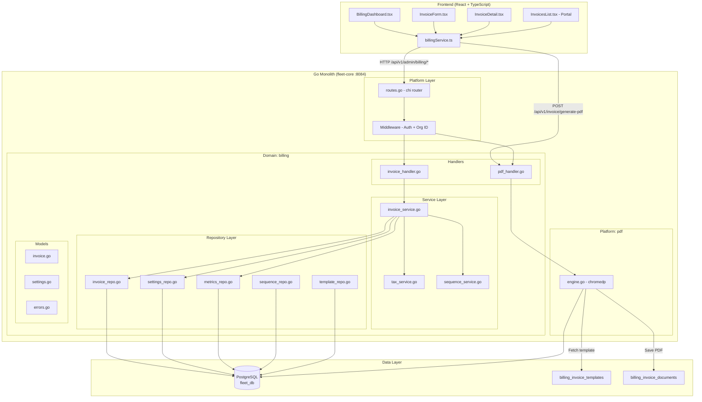

# ADR-001: Invoice Generator Architecture

> **Status:** Proposed  
> **Date:** 2026-04-03  
> **Branch:** `feature/invoice-generation`  
> **Author:** Senior Architect  

---

## Context

FlyFleet has a **complete billing database schema** (15 migrations, 15+ tables), a **polished React frontend** (5 pages), and a **sophisticated Svelte template designer** — but **zero backend implementation**. The frontend calls API endpoints that return 404/500.

### Existing Infrastructure
| Component | Status | Details |
|-----------|--------|---------|
| Database schema | ✅ Complete | 15 migrations, 15+ tables |
| Frontend (React) | ✅ Complete | 5 pages, billingService.ts, TypeScript types |
| Svelte template designer | ✅ Complete | GST-compliant, 9 blocks, drag-and-drop |
| HTML templates | ⚠️ Partial | 2 static HTML files + 2 DB-seeded Go templates |
| Proto definitions | ⚠️ Minimal | 3 RPCs, all unimplemented |
| **Go backend** | ❌ Missing | Zero implementation |
| **PDF engine** | ❌ Missing | chromedp + gofpdf both in go.mod but unused |

### Architecture Assessment Results
- **Pattern:** Layered architecture (45% confidence — early stage monolith)
- **Size:** 868 files, 144K lines of Go
- **Dependencies:** 168 direct, **0 circular dependencies** (clean)
- **Coupling score:** 0/100 (low — good)
- **chromedp:** Already in go.mod (`v0.14.2`) ✅
- **gofpdf:** Already in go.mod (`v0.9.0`) ✅

### Existing Domain Pattern (from `trip` domain)
```
internal/domains/trip/
├── handlers/
│   ├── trip_handler.go       # HTTP handlers with DTOs, validation
│   └── trip_handler_test.go
├── models/
│   ├── trip.go               # Domain structs
│   └── trip_lifecycle.go
├── repository/
│   ├── trip_repository.go    # DB access layer
│   └── trip_offer_repository.go
└── service/
    ├── errors.go             # Domain errors
    └── financial_service.go  # Business logic
```

### Existing Route Registration (from `platform/billing/`)
```
internal/platform/billing/
└── routes.go  (exists but empty or minimal)
```

---

## Decision

### Architecture: Layered Monolith (Follow Existing Pattern)

We will build the invoice generator as a **new domain module** following the established `trip`/`driver` domain pattern within the existing Go monolith.

```
services/fleet-core/internal/
├── domains/billing/
│   ├── models/
│   │   ├── invoice.go          # Invoice, InvoiceItem, DTOs
│   │   ├── settings.go         # BillingSettings, BillingMetrics
│   │   └── errors.go           # Domain errors
│   ├── repository/
│   │   ├── invoice_repo.go     # CRUD for invoices + items
│   │   ├── settings_repo.go    # Billing settings
│   │   ├── metrics_repo.go     # Aggregated metrics
│   │   ├── sequence_repo.go    # Invoice numbering
│   │   └── template_repo.go    # HTML templates
│   ├── service/
│   │   ├── invoice_service.go  # Business logic (create, update, tax)
│   │   ├── tax_service.go      # Tax calculation
│   │   └── sequence_service.go # Invoice number generation
│   └── handlers/
│       ├── invoice_handler.go      # HTTP handlers (9 endpoints)
│       ├── pdf_handler.go          # PDF generation endpoint
│       └── invoice_handler_test.go # Unit tests
├── platform/billing/
│   └── routes.go               # Route registration to chi router
└── platform/pdf/
    └── engine.go               # PDF generation engine (chromedp)
```

### Why This Pattern?

| Factor | Decision | Rationale |
|--------|----------|-----------|
| **Architecture** | Layered monolith | Matches existing fleet-core pattern, team of 1-2 devs |
| **PDF Engine** | chromedp (primary) + gofpdf (fallback) | chromedp = pixel-perfect HTML→PDF from existing templates; gofpdf = lightweight fallback |
| **Tax Calculation** | Flat rate from billing_settings | Simple MVP; region-based tax engine deferred to Phase 3 |
| **Invoice Numbering** | PostgreSQL sequence | Atomic, no race conditions, format: `INV-2026-001` |
| **Payment Recording** | Manual entry only (MVP) | Payment gateway (Razorpay/Stripe) deferred to Phase 2 |
| **Async Workers** | Not in MVP | Monthly auto-invoicing deferred to Phase 2 |
| **gRPC Service** | Not in MVP | REST-only for MVP; gRPC deferred to Phase 2 |

---

## Architecture Diagram



---

## API Contract

### Admin Endpoints (`/api/v1/admin`)

| # | Method | Endpoint | Handler | Request | Response | Status |
|---|--------|----------|---------|---------|----------|--------|
| 1 | `GET` | `/billing/invoices` | `ListInvoices` | `?page=1&size=10&org_id=...` | `{data: Invoice[], total: int}` | 200 |
| 2 | `GET` | `/billing/invoices/:id` | `GetInvoice` | — | `Invoice` (with items) | 200 |
| 3 | `POST` | `/billing/invoices` | `CreateInvoice` | `{customer_name, invoice_date, due_date, items[]}` | `Invoice` | 201 |
| 4 | `PUT` | `/billing/invoices/:id` | `UpdateInvoice` | `{customer_name?, items?, notes?}` | `Invoice` | 200 |
| 5 | `DELETE` | `/billing/invoices/:id` | `DeleteInvoice` | — | `204 No Content` | 204 |
| 6 | `POST` | `/billing/invoices/:id/payments` | `RecordPayment` | `{amount: float}` | `{amount_paid, balance_due}` | 200 |
| 7 | `GET` | `/billing-settings` | `GetSettings` | — | `BillingSettings` | 200 |
| 8 | `PUT` | `/billing-settings` | `UpdateSettings` | `{default_tax_rate, base_currency, ...}` | `BillingSettings` | 200 |
| 9 | `GET` | `/billing-metrics` | `GetMetrics` | — | `BillingMetrics` | 200 |

### PDF Endpoint

| # | Method | Endpoint | Handler | Request | Response | Status |
|---|--------|----------|---------|---------|----------|--------|
| 10 | `POST` | `/api/v1/invoice/generate-pdf` | `GeneratePDF` | `{invoice_id: string, template_id?: string}` | `application/pdf` (binary) | 200 |

### Portal Endpoint

| # | Method | Endpoint | Handler | Request | Response | Status |
|---|--------|----------|---------|---------|----------|--------|
| 11 | `GET` | `/api/v1/portal/invoices` | `ListCustomerInvoices` | `?page=1&size=10` | `{data: Invoice[], total: int}` | 200 |

---

## Data Flow

### Invoice Creation Flow
```
1. Client POST /api/v1/admin/billing/invoices
   ↓
2. Handler validates DTO (go-playground/validator)
   ↓
3. Service: Get next invoice number from sequence (PostgreSQL SEQUENCE)
   ↓
4. Service: Calculate tax from billing_settings.default_tax_rate
   ↓
5. Service: Calculate subtotal, tax_amount, total_amount, balance_due
   ↓
6. Repository: BEGIN transaction
   ↓
7. Repository: INSERT INTO invoices (with invoice_number, org_id, ...)
   ↓
8. Repository: INSERT INTO invoice_items (for each line item)
   ↓
9. Repository: COMMIT
   ↓
10. Handler: Return 201 with Invoice JSON
```

### PDF Generation Flow
```
1. Client POST /api/v1/invoice/generate-pdf {invoice_id}
   ↓
2. Handler: Fetch invoice + items from repository
   ↓
3. PDF Engine: Fetch HTML template from billing_invoice_templates
   ↓
4. PDF Engine: Execute Go html/template with invoice data
   ↓
5. PDF Engine: chromedp — launch headless Chrome
   ↓
6. PDF Engine: Navigate to data: URI with rendered HTML
   ↓
7. PDF Engine: Emulate print media, A4 size, capture PDF bytes
   ↓
8. PDF Engine: Save PDF to billing_invoice_documents table
   ↓
9. Handler: Return PDF as application/octet-stream (download)
```

---

## Database Operations

### Invoice Number Sequencing
```sql
-- Create sequence per year
CREATE SEQUENCE IF NOT EXISTS invoice_seq_2026 START 1;

-- Get next number (atomic, no race conditions)
SELECT nextval('invoice_seq_2026');  -- Returns 1, 2, 3...

-- Format in Go
invoiceNumber := fmt.Sprintf("INV-2026-%03d", seq)  -- INV-2026-001
```

### Tax Calculation
```sql
-- Get org's default tax rate
SELECT default_tax_rate FROM billing_settings WHERE org_id = $1;

-- Calculate in Go service layer
subtotal := 0.0
for _, item := range items {
    subtotal += float64(item.Quantity) * item.UnitPrice
}
taxAmount := subtotal * (taxRate / 100)
totalAmount := subtotal + taxAmount
```

### Metrics Aggregation
```sql
-- Total invoiced this month
SELECT COALESCE(SUM(total_amount), 0)
FROM invoices
WHERE org_id = $1
  AND invoice_date >= date_trunc('month', CURRENT_DATE)
  AND is_deleted = false;

-- Pending payments
SELECT COALESCE(SUM(balance_due), 0)
FROM invoices
WHERE org_id = $1 AND status IN ('sent', 'viewed') AND is_deleted = false;

-- Overdue amount
SELECT COALESCE(SUM(balance_due), 0)
FROM invoices
WHERE org_id = $1 AND status = 'overdue' AND is_deleted = false;

-- Paid count
SELECT COUNT(*) FROM invoices
WHERE org_id = $1 AND status = 'paid' AND is_deleted = false;

-- Open count
SELECT COUNT(*) FROM invoices
WHERE org_id = $1 AND status IN ('sent', 'viewed') AND is_deleted = false;
```

---

## Trade-offs Accepted

| Trade-off | Decision | Why |
|-----------|----------|-----|
| chromedp vs gofpdf | chromedp primary, gofpdf fallback | chromedp renders existing HTML templates pixel-perfect; gofpdf is lighter but requires rebuilding templates |
| Flat tax vs region-based tax | Flat rate (MVP) | 95% of FlyFleet customers are India-based with single GST rate; region-based tax deferred |
| Manual payments vs gateway | Manual entry (MVP) | Payment gateway integration (Razorpay) is a separate epic; record payment manually for now |
| REST vs gRPC | REST-only (MVP) | Frontend already uses REST; gRPC adds complexity with no immediate benefit |
| Sync vs async PDF | Sync generation | PDF generation is fast (<2s with chromedp); async queue adds complexity for no gain at current scale |
| PDF caching | Cache on first generation | Store in `billing_invoice_documents`, serve cached copy on subsequent downloads |

---

## Risks & Mitigations

| Risk | Impact | Probability | Mitigation |
|------|--------|-------------|------------|
| chromedp requires Chrome binary on server | High | Medium | Use `chromedp/headless-shell` Docker image; fallback to gofpdf |
| PDF generation slow at scale | Medium | Low | Cache PDFs in `billing_invoice_documents`; async queue for bulk generation |
| Template rendering bugs (Go html/template) | Medium | Medium | Unit test templates with sample data before deploy |
| Invoice sequence race condition | High | Low | Use PostgreSQL SEQUENCE (atomic), not application counter |
| Frontend/backend status mismatch | Medium | Medium | Standardize: lowercase in DB (`sent`, `paid`), uppercase in UI (`SENT`, `PAID`), convert in service layer |
| Large file bloat (existing pattern) | Low | High | Keep billing files focused; target <300 lines per file |

---

## Implementation Order

```
Phase 1: Foundation (Day 1-2)
├── models/invoice.go        — Domain structs + DTOs
├── models/settings.go       — Settings + Metrics structs
├── models/errors.go         — Domain errors
├── repository/invoice_repo.go — CRUD operations
├── repository/settings_repo.go — Settings CRUD
├── repository/metrics_repo.go — Metrics aggregation
├── repository/sequence_repo.go — Invoice numbering
└── repository/template_repo.go — Template fetching

Phase 2: Service Layer (Day 2-3)
├── service/invoice_service.go — Business logic
├── service/tax_service.go     — Tax calculation
└── service/sequence_service.go — Number generation

Phase 3: HTTP Handlers (Day 3-4)
├── handlers/invoice_handler.go — 9 admin endpoints
├── handlers/pdf_handler.go    — PDF generation
└── handlers/invoice_handler_test.go — Unit tests

Phase 4: PDF Engine (Day 4-5)
├── platform/pdf/engine.go     — chromedp PDF generator
└── platform/billing/routes.go — Route registration

Phase 5: Frontend Integration (Day 5-6)
├── billingService.ts fixes    — API path corrections
├── InvoiceForm.tsx wiring     — Connect create/edit
├── InvoiceDetail.tsx wiring   — PDF download
└── BillingDashboard.tsx wiring — Real metrics

Phase 6: Testing & Polish (Day 6-7)
├── Integration tests          — HTTP endpoint tests
├── E2E test                   — Create → View → Download PDF
└── Load test                  — 100 concurrent PDF generations
```

---

## Acceptance Criteria

### Backend
- [ ] All 11 API endpoints return correct responses (200/201/204)
- [ ] Invoice creation generates auto-incremented invoice_number
- [ ] Tax calculation matches billing_settings.default_tax_rate
- [ ] Soft delete sets is_deleted = true (not physical delete)
- [ ] Record payment updates amount_paid and recalculates balance_due
- [ ] PDF generation returns valid PDF (Content-Type: application/pdf, >0 bytes)
- [ ] PDF contains: invoice number, customer, line items, subtotal, tax, total, due date
- [ ] Metrics endpoint returns accurate aggregations

### Frontend
- [ ] InvoiceForm.tsx successfully creates invoices via API
- [ ] InvoiceDetail.tsx shows invoice with line items + PDF download
- [ ] BillingDashboard.tsx shows real metrics (not mock data)
- [ ] InvoicesList.tsx (portal) shows customer's invoices with PDF links

### Quality
- [ ] Unit tests for repository layer (≥80% coverage)
- [ ] Unit tests for service layer (≥80% coverage)
- [ ] Integration tests for all 11 endpoints
- [ ] No goroutine leaks in chromedp (proper context cancellation)
- [ ] All database constraints respected (FK, CHECK, NOT NULL)

---

## Future Phases

### Phase 2: Automation (Week 4-5)
- Monthly auto-invoicing cron job (async worker)
- Email delivery (SendGrid/SES)
- Payment gateway integration (Razorpay for India)
- gRPC BillingService implementation
- Dunning management (retry failed payments)

### Phase 3: Advanced (Week 6-8)
- Multi-currency with FX rates
- Region-based tax engine (CGST/SGST/IGST)
- Credit notes and refunds
- Accounting exports (QuickBooks, Tally)
- Usage-based billing (TimescaleDB aggregation)
- Invoice approval workflows
- e-Invoice IRN integration (India GST)
