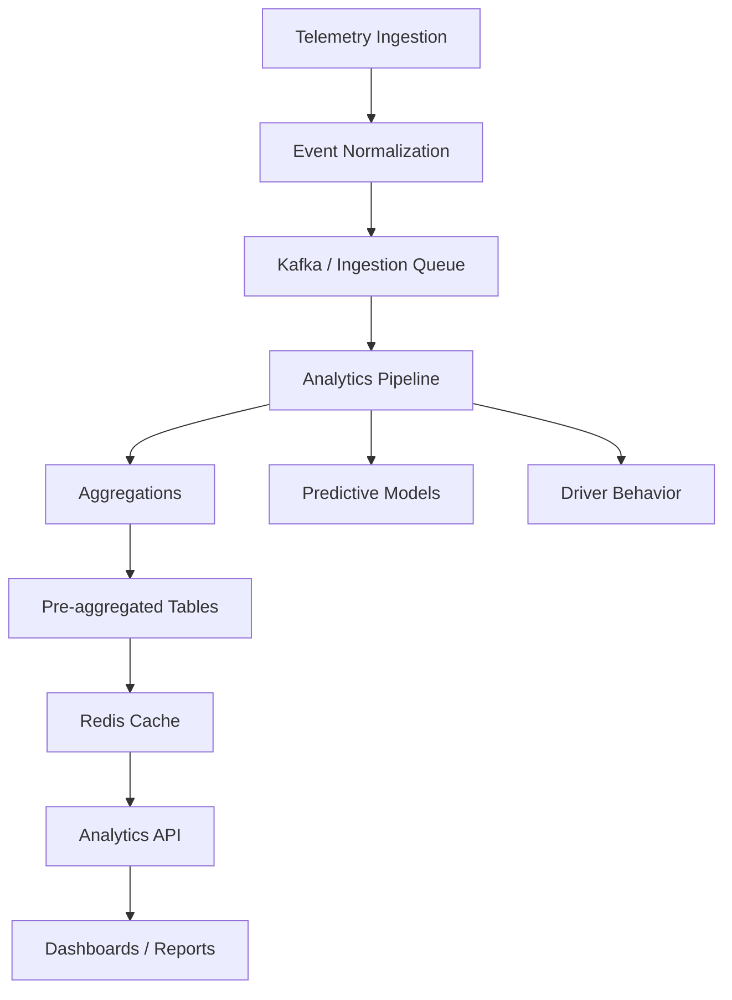

# Analytics Module (ID 3) — Complete Technical Specification

## 1. Purpose

The analytics module converts raw telemetry and operational data into:

- Fleet operational intelligence
- Driver safety insights
- Predictive maintenance alerts
- Behavior scoring
- Business dashboards
- Trend forecasting

**Primary consumers:**

- Fleet managers
- Safety teams
- Operations dashboards
- AI / predictive models
- Alerts system
- Reporting APIs

## 2. Upstream Data Sources

Analytics consumes data from multiple domains:

- **Telemetry**: Vehicle location, speed, acceleration, engine metrics, temperature, fault codes.
- **Trips**: Trip start, trip end, distance, duration, driver assignment.
- **Driver Logs**: Login/logout, HOS state, fatigue indicators, duty status.
- **Device Events**: Camera alerts, tamper events, power loss, device health.
- **Alerts**: Overspeed, panic, harsh braking, collision.
- **Maintenance Records**: Service history, component replacement, diagnostics.

## 3. Data Flow Architecture

## 4. Domain Components

- **Handlers**: REST API endpoints.
- **Service**: Business logic and orchestration.
- **Repository**: Database abstraction (PostgreSQL).
- **Cache**: Performance layer (Redis).
- **Predictive Models**: ML model management and scoring.
- **Driver Behavior**: Safety and efficiency scoring.
- **Fleet Analytics**: KPIs and utilization metrics.
- **Aggregations**: Background data processors.
- **Async Jobs**: Long-running analytics tasks via Asynq.
- **Cost Guard**: Pre-execution query complexity protection.
- **Query Profiler**: Slow query observation and planning.
- **Tenant Guard**: Multi-tenant isolation enforcement.

**Infrastructure:**

- PostgreSQL (pgx)
- Redis
- Asynq (Background Workers)
- Prometheus (Metrics)
- Zap (Structured Logging)

## 5. Database Schema

- **predictive_models**: registry of ML models.
- **prediction_results**: scored entities with confidence and anomaly detection.
- **fleet_hourly_stats**: hourly rollups of active vehicles/drivers, distance, fuel.
- **vehicle_daily_stats**: per-vehicle daily metrics (overspeed, harsh braking, engine hours).
- **driver_daily_stats**: per-driver behavior and safety metrics.
- **analytics_jobs**: background job state tracking.
- **analytics_query_logs**: performance audit trail for analytics queries.

## 6. Fleet Analytics Engine

Calculates operational metrics:

- Active vehicles & utilization rate.
- Fleet-wide distance and fuel efficiency.
- Idle time and trip completion rates.
- Alert density per 100km.

## 7. Driver Behavior Engine

Calculates driver safety score based on analyzed signals: overspeed, harsh braking, rapid acceleration, sharp turns, lane drift, fatigue indicators, and idle abuse.

**Safety Score Formula:**
`score = 100 - (overspeed_events × 2) - (harsh_brake × 3) - (fatigue_event × 5)`

**Risk Classification:**

- 90–100: Safe
- 75–90: Moderate
- 50–75: Risky
- <50: Dangerous

## 8. Predictive Maintenance

Uses telemetry patterns (temp, voltage, fault codes) to predict vehicle failures.

- **Output**: failure_probability, predicted_failure_date, component_at_risk.

## 9. Aggregation System

Pre-computed analytics tables via background workers:

- Hourly fleet aggregation.
- Daily vehicle aggregation.
- Daily driver aggregation.
- Weekly behavior aggregation.

## 10. Redis Cache Layer

- **Cache Patterns**: `analytics:{orgID}:fleet:v{version}`, `analytics:{orgID}:vehicle:{vehicleID}`, `analytics:{orgID}:driver:{driverID}`, `analytics:{orgID}:query:{hash}`.
- **TTL**: Fleet (5m), Vehicle (2m), Driver (5m).

## 11. Intelligent Cache Invalidation

- **Triggers**: Telemetry ingestion, driver login/logout, HOS changes, job completion.
- **Methods**: `InvalidateVehicleCache`, `InvalidateDriverCache`, `InvalidateFleetCache`.
- **Debounce Window**: 5–10 seconds.
- **Fleet Versioning**: Increment global version to avoid large deletions.

## 12. Query Cost Guard

Prevents expensive analytics queries by running `EXPLAIN` to estimate cost and rejecting if it exceeds thresholds.

## 13. Slow Query Profiler

If query duration **> 2 seconds**, the system automatically triggers an `EXPLAIN ANALYZE` and stores the execution plan in logs for diagnostic optimization.

## 14. Async Analytics Jobs

Heavy queries (e.g., trend analysis, maintenance training) are processed asynchronously via **Asynq**.

## 15. Multi-Tenant Isolation

- **Layers**: PostgreSQL RLS, TenantGuard middleware, orgID propagation, tenant-isolated cache keys.
- **Metric**: `analytics_cross_tenant_attempts_total`.

## 16. Performance Safeguards

- **30 second** query timeout.
- **90 day** query range limit.
- **1000 row** synchronous query limit.

## 17. API Endpoints

- **Fleet**: `GET /analytics/fleet/summary`, `GET /analytics/fleet/hourly`
- **Stats**: `GET /stats/vehicle/{id}`, `GET /stats/driver/{id}`
- **Models**: `GET /analytics/models`, `POST /analytics/models`
- **Predictions**: `GET /analytics/predictions`
- **Jobs**: `POST /analytics/jobs`, `GET /analytics/jobs/{id}`

## 18. Observability

Logs and metrics for query execution, slow query plans, cache hits/misses, and job lifecycles.

## 19. Scaling Strategy

- **Current**: Hundreds of queries/min, thousands of jobs/hour.
- **Future**: Kafka telemetry pipeline, ClickHouse columnar DB, ML pipelines.

## 20. Responsibilities of This Module

- Fleet performance analytics
- Driver safety analysis
- Predictive maintenance
- Analytics dashboards
- Trend forecasting
- Risk detection

---

_The Analytics module is the data intelligence layer of the platform._
